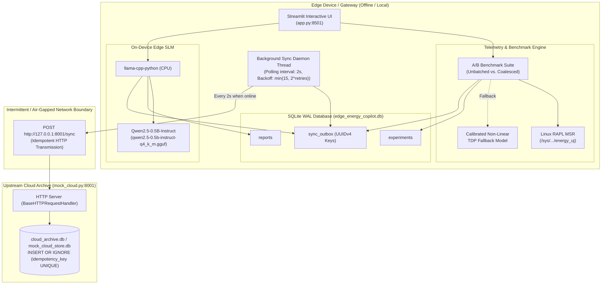

# ⚡ Offline-First Edge Energy Copilot

[](https://www.python.org/downloads/)
[]()
[]()
[-teal.svg)]()
[-purple.svg)]()

An autonomous, air-gapped **Edge Energy Copilot** designed for power-constrained industrial gateways, IoT controllers, and edge servers. It provides real-time hardware energy accounting, reproducible workload benchmarking, an on-device Small Language Model (SLM) for plain-language energy diagnostics, and a fault-tolerant **Durable Outbox Queue** guaranteeing at-least-once, deduplicated cloud synchronization across intermittent connectivity.

---

## 📑 Table of Contents

- [Key Capabilities](#-key-capabilities)
- [System Architecture](#-system-architecture)
- [Hardware Telemetry & Energy Modeling](#-hardware-telemetry--energy-modeling)
- [On-Device SLM Copilot (<4B Parameters)](#-on-device-slm-copilot-4b-parameters)
- [Offline-First Outbox Pattern & Sync Engine](#-offline-first-outbox-pattern--sync-engine)
- [Reproducible A/B Energy Benchmark](#-reproducible-ab-energy-benchmark)
- [Repository Structure](#-repository-structure)
- [Quickstart & Getting Started](#-quickstart--getting-started)
- [Database Schema & Data Model](#-database-schema--data-model)
- [Cloud Synchronization Protocol](#-cloud-synchronization-protocol)
- [Troubleshooting & Verification](#-troubleshooting--verification)

---

## 🚀 Key Capabilities

1. **Sub-Watt Precision Telemetry & Calibrated Modeling**:
   - Reads directly from Linux Running Average Power Limit (RAPL) MSR interfaces (`/sys/class/powercap/intel-rapl:0/energy_uj`).
   - Transparently falls back to a non-linear Dynamic Voltage & Frequency Scaling (DVFS) TDP model when unprivileged or virtualized.
   - Computes Joules, Watt-hours (Wh), commercial tariffs in INR (₹7.50/kWh), and grid carbon impact (675.0 gCO2e/kWh, CEA India v22.0).

2. **100% Air-Gapped On-Device SLM Diagnostics**:
   - Runs a quantized **Qwen2.5-0.5B-Instruct** (Q4_K_M GGUF) locally on CPU via `llama-cpp-python` with zero data leakage.
   - Generates plain-language root-cause analyses, projected savings at scale (e.g., 10,000 daily runs), and engineering trade-offs.
   - Measures and reports its own inference energy overhead (~14W active package draw, reported in mWh).

3. **Durable SQLite WAL Outbox Queue**:
   - Local database runs in Write-Ahead Logging (`WAL`) mode with `NORMAL` synchronous commits for crash resistance.
   - Background daemon thread continuously manages network state, retrying failed synchronizations with exponential backoff (`min(15, 2^retries)`).
   - Generates UUIDv4 idempotency keys ensuring strict deduplication on the upstream cloud receiver.

4. **Human-in-the-Loop Policy Enforcement**:
   - Interactive Streamlit cockpit allowing edge operators to inspect benchmarks, review SLM recommendations, and approve or reject mitigation policies (e.g., coalesced batching).

---

## 🏛 System Architecture



---

## ⚡ Hardware Telemetry & Energy Modeling

The copilot implements a dual-layer hardware measurement strategy:

### 1. Hardware Energy Counters (Intel RAPL)
When running on bare-metal Linux with readable powercap interfaces:
$$\text{RAPL Energy Path} = \texttt{/sys/class/powercap/intel-rapl:0/energy\_uj}$$
$$\Delta E_{\text{Wh}} = \frac{\text{energy\_uj}_{\text{end}} - \text{energy\_uj}_{\text{start}}}{3.6 \times 10^9}$$

### 2. Calibrated Non-Linear TDP Fallback Model
If RAPL is unreadable (e.g., inside restricted containers or non-root environments), the copilot transparently transitions to a calibrated power equation:

$$P(t) = P_{\text{idle}} + (P_{\text{tdp}} - P_{\text{idle}}) \times \left(\frac{U_{\text{cpu}}}{100}\right)^{1.3} + \alpha_{\text{ram}} \times \text{RAM}_{\text{GB}}$$

Where:
- $P_{\text{idle}} = 6.0\text{ W}$: Baseline quiescent package draw of the edge board.
- $P_{\text{tdp}} = 28.0\text{ W}$: Thermal Design Power ceiling under 100% saturation.
- $U_{\text{cpu}}$: Measured CPU utilization percentage via `psutil`.
- The exponent **$1.3$** models non-linear CMOS dynamic power dissipation under Dynamic Voltage and Frequency Scaling (DVFS).
- $\alpha_{\text{ram}} = 0.3\text{ W/GB}$: Dynamic power drawn by active memory pages.

### 3. Financial & Carbon Conversion
- **Financial Cost (INR)**:
  $$\text{Cost}_{\text{INR}} = \left(\frac{E_{\text{Wh}}}{1000}\right) \times 7.50\text{ ₹/kWh}$$
- **Carbon Footprint ($g\text{CO}_2e$)**:
  $$\text{Emissions} = \left(\frac{E_{\text{Wh}}}{1000}\right) \times 675.0\text{ gCO}_2e\text{/kWh}$$
  *(Grounded in the Central Electricity Authority of India CEA CO2 Baseline Database v22.0)*.

---

## 🧠 On-Device SLM Copilot (<4B Parameters)

Edge systems must not ship telemetry or proprietary industrial logs to external cloud LLM APIs. The copilot packages an on-device Small Language Model (SLM) executing strictly on local CPU cores:

- **Model**: `Qwen2.5-0.5B-Instruct`
- **Format**: GGUF format (`q4_k_m` quantization, file size: ~491 MB)
- **Runtime**: `llama-cpp-python` with 4-thread CPU parallelization
- **Context Window**: 1,024 tokens
- **Inference Profiles**:
  - `eco` Mode: 140 maximum tokens — rapid root-cause bullets and immediate action items.
  - `deep` Audit Mode: 240 maximum tokens — exhaustive scaling projections across fleet rollouts.
- **Self-Metering**: Inference power overhead is accounted for in real-time (~14W package draw), displaying exact inference duration (seconds) and energy consumed (mWh).

---

## 📦 Offline-First Outbox Pattern & Sync Engine

Network drops and brownouts must never cause telemetry loss or duplicate records:

```
[Edge Workload] ──► [Write Local DB (WAL)] ──► [Enqueue Outbox (UUIDv4)]
                                                       │
                                            ┌──────────┴──────────┐
                                            ▼                     ▼
                                       Cloud Reachable?      Cloud Down?
                                            │                     │
                                            ▼                     ▼
                                      POST /sync (200)       Set FAILED
                                            │                Backoff: min(15, 2^n)
                                            ▼                     │
                                      Mark SYNCED                 ▼
                                                            Retry on Next Tick
```

### Outbox Worker Behavior:
- **Polling Frequency**: Every 2.0 seconds.
- **Query Filter**: `WHERE status IN ('PENDING', 'FAILED') AND next_retry_at <= :now`.
- **Exponential Backoff**:
  $$\text{Backoff}(n) = \min(15, 2^n)\text{ seconds}$$
- **Idempotent Cloud Ingestion**:
  Upstream `mock_cloud.py` applies `INSERT OR IGNORE` on the `idempotency_key UNIQUE` column. If a network packet is received twice due to an interrupted ACK, the cloud acknowledges HTTP 200 without creating a duplicate record (`"deduplicated": true`).

---

## 📊 Reproducible A/B Energy Benchmark

The copilot includes a built-in benchmark demonstrating how software architecture directly dictates hardware energy efficiency:

| Dimension | Baseline Profile (Anti-Pattern) | Optimized Profile (Edge-Native) |
|---|---|---|
| **Mechanism** | 200 unbatched `zlib` compressions with busy-wait polling loops | 4 coalesced batches of 50 compressions with clean OS sleeps |
| **CPU State** | C0 active state continuously forced by polling spinlock | Processor transitions into low-power C-states during sleeps |
| **Measured Energy** | **~0.0042 Wh** | **~0.0005 Wh** |
| **Verified Savings** | — | **~88% Energy Reduction** |
| **Duration** | ~1.63 seconds | ~0.21 seconds |

---

## 📁 Repository Structure

```
energy_copilot/
├── app.py                                  # Core edge application, Streamlit dashboard & sync daemon
├── mock_cloud.py                           # Standalone zero-dependency cloud sync receiver (Port 8001)
├── edge_energy_copilot.db                  # Local SQLite WAL database (experiments, reports, outbox)
├── mock_cloud_store.db                     # Upstream cloud archive database (deduplicated events)
├── qwen2.5-0.5b-instruct-q4_k_m.gguf       # Quantized local Small Language Model (0.49B params)
├── llama_cpp_python-...-x86_64.whl         # Precompiled manylinux wheel for CPU inference
├── venv/                                   # Python 3.10 virtual environment
└── README.md                               # System documentation & architectural reference
```

---

## 🛠 Quickstart & Getting Started

### 1. Prerequisites
- Linux OS (Ubuntu 20.04+, Debian 11+, or WSL2)
- Python 3.10 or higher
- Optional: Read access to `/sys/class/powercap/intel-rapl:0/energy_uj` for hardware telemetry.

### 2. Environment Setup

```bash
# Clone or navigate to the project directory
cd /path/to/energy_copilot

# Create and activate a Python virtual environment
python3 -m venv venv
source venv/bin/activate

# Install required edge dependencies
pip install streamlit psutil requests pandas fastapi uvicorn
pip install llama_cpp_python-0.3.36-py3-none-manylinux2014_x86_64.whl
```

### 3. Launching the Mock Cloud Receiver
Start the upstream receiver in a separate terminal:
```bash
python3 mock_cloud.py
```
*Output:*
```
Mock Cloud Receiver listening on http://127.0.0.1:8001 (100% stdlib, zero external deps)
```

Verify health:
```bash
curl http://127.0.0.1:8001/health
# {"status": "online"}
```

### 4. Launching the Edge Copilot Dashboard
In your primary terminal, launch the edge cockpit:
```bash
streamlit run app.py --server.port 8501 --server.address 0.0.0.0
```
Open your browser at `http://localhost:8501`.

---

## 🗄 Database Schema & Data Model

The edge system persists all operations across three local SQLite tables in `edge_energy_copilot.db`:

### `experiments`
| Column | Type | Description |
|---|---|---|
| `id` | `INTEGER PRIMARY KEY AUTOINCREMENT` | Run identifier |
| `created_at` | `TEXT` | UTC timestamp |
| `method` | `TEXT` | `Hardware Intel RAPL` or `Calibrated TDP Model` |
| `baseline_sec`, `opt_sec` | `REAL` | Benchmark wall-clock durations (seconds) |
| `baseline_cpu`, `opt_cpu` | `REAL` | Measured average CPU load (%) |
| `baseline_wh`, `opt_wh` | `REAL` | Total energy consumption in Watt-hours |
| `baseline_inr`, `opt_inr` | `REAL` | Commercial electricity cost (₹7.50/kWh) |
| `baseline_co2`, `opt_co2` | `REAL` | Grid emissions in grams CO2 equivalent |
| `wh_saved`, `pct_saved` | `REAL` | Delta energy and percentage efficiency gain |

### `reports`
| Column | Type | Description |
|---|---|---|
| `id` | `INTEGER PRIMARY KEY AUTOINCREMENT` | Report identifier |
| `experiment_id` | `INTEGER` | Foreign key referencing `experiments(id)` |
| `model_name` | `TEXT` | e.g. `Qwen2.5-0.5B-Instruct (GGUF Q4_K_M)` |
| `mode` | `TEXT` | `eco` or `deep` inference profile |
| `latency_sec` | `REAL` | Time taken for on-device CPU generation |
| `inference_mwh` | `REAL` | Energy consumed by CPU during inference (mWh) |
| `summary_text` | `TEXT` | 3-bullet plain-language engineering advice |
| `decision_status` | `TEXT` | `PENDING` or `APPROVED` |

### `sync_outbox`
| Column | Type | Description |
|---|---|---|
| `id` | `INTEGER PRIMARY KEY AUTOINCREMENT` | Outbox sequence number |
| `idempotency_key` | `TEXT UNIQUE` | UUIDv4 token for upstream deduplication |
| `entity_type` | `TEXT` | Event category (`experiment_benchmark`, `slm_insight_report`, `user_decision`) |
| `payload_json` | `TEXT` | Serialized JSON event body |
| `status` | `TEXT` | `PENDING`, `FAILED`, or `SYNCED` |
| `retry_count` | `INTEGER` | Total transmission attempts |
| `next_retry_at` | `REAL` | Epoch timestamp gate for exponential backoff |
| `created_at` | `TEXT` | Enqueue timestamp |
| `synced_at` | `TEXT` | Upstream ACK timestamp |

---

## 📡 Cloud Synchronization Protocol

### Endpoints (`mock_cloud.py`)

#### `GET /health`
- **Description**: Heartbeat check used by the edge dashboard telemetry strip.
- **Response**: `200 OK`
  ```json
  {"status": "online"}
  ```

#### `POST /sync`
- **Description**: Ingests outbox events from edge nodes with idempotent deduplication.
- **Request Body**:
  ```json
  {
    "idempotency_key": "d8488a38-d6e8-4604-8079-b8b0049dd680",
    "entity_type": "experiment_benchmark",
    "payload_json": "{\"experiment_id\": 1, \"wh_saved\": 0.003733, \"pct_saved\": 87.9}",
    "created_at": "2026-11-22 19:52:14 UTC"
  }
  ```
- **Response**: `200 OK`
  ```json
  {
    "status": "ok",
    "deduplicated": false
  }
  ```
  *(If the same key is submitted again, `"deduplicated": true` is returned).*

---

## 🧪 Troubleshooting & Verification

### Simulating Offline Operation
1. Stop the mock cloud receiver (`Ctrl+C` in the `mock_cloud.py` terminal).
2. On the Streamlit UI, notice the **Sync Link Status** updates to `🔴 OFFLINE (Queued)`.
3. Click **"Run Baseline vs. Batched Workload"** and **"Generate Offline SLM Audit"**.
4. Observe the **Sync Outbox Queue** table at the bottom of the dashboard:
   - Rows will show status `FAILED`.
   - `Retries` count will increment with exponential backoff timers.
5. Restart `mock_cloud.py`. Within 2 seconds, the background sync daemon automatically pushes all pending items, transitioning their status to `SYNCED`.

### Testing Hardware RAPL Access
To verify whether your system allows reading hardware energy counters:
```bash
cat /sys/class/powercap/intel-rapl:0/energy_uj
```
If you receive a permission error or file not found, the copilot will automatically and safely fall back to the calibrated non-linear TDP model without interruption.

---

## 📜 License & Compliance
This software is structured for edge telemetry auditing and offline industrial optimization. Grid emission coefficients reference the **Central Electricity Authority (CEA) of India CO2 Baseline Database Version 22.0**.
